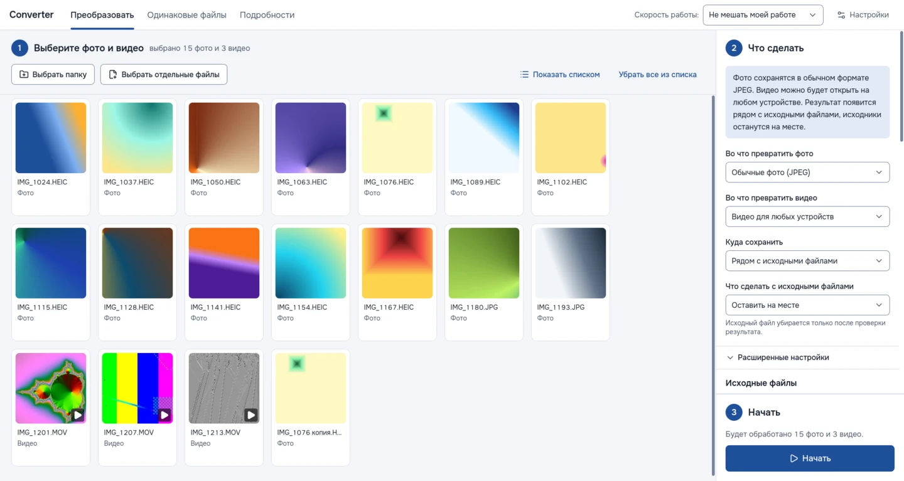

<div align="center">


# Converter

**Переводит фото и видео с телефона в форматы, которые открываются везде, и находит одинаковые файлы.**

Для Windows и Linux. Бесплатно, без рекламы и интернета — всё делается на вашем компьютере.

[](https://github.com/Worton1720/converter/releases/latest)
[](https://github.com/Worton1720/converter/actions/workflows/ci.yml)
[](LICENSE)



</div>

## Зачем

iPhone снимает фото в HEIC и видео в HEVC. На многих компьютерах, телевизорах и старых телефонах они не открываются, а сайты и почта их не принимают. Converter превращает их в обычные JPEG и MP4 — без потери качества, даты съёмки и цветов.

А за годы на диске копятся одни и те же снимки: в «Загрузках», на флешке, в архиве. Converter находит файлы с одинаковым содержимым, даже если они называются по-разному, и убирает лишние копии в корзину.

## Что умеет

**Фото и видео**
- Фото HEIC с iPhone, а также PNG, WebP, TIFF, BMP → JPEG, PNG или WebP.
- Видео с iPhone → MP4, который откроется на любом устройстве; или более компактные HEVC, WebM, MKV.
- Сохраняет дату съёмки, правильный поворот и цвета; по желанию стирает место съёмки.
- Если видео уже подходит, просто перепаковывает его — за секунды, без пережатия.
- Использует видеокарту (Intel, NVIDIA, AMD), чтобы видео готовилось быстрее.

**Одинаковые файлы**
- Сравнивает содержимое, а не имена: находит копии с разными названиями.
- Находит одно фото, сохранённое дважды в разных форматах (снимок с iPhone и его копию JPEG), и предлагает оставить один формат.
- Сам предлагает, какую копию оставить; можно посмотреть две копии рядом и выбрать вручную.
- В каждой группе всегда остаётся хотя бы один файл.

**Бережёт ваши файлы и компьютер**
- Исходники по умолчанию остаются на месте. Если выбрать «убрать в корзину», файл уберётся только после проверки результата.
- Если работа прервётся, недоделанных файлов не останется.
- Режим «Не мешать моей работе» следит за загрузкой компьютера и уступает другим программам; на ноутбуке бережёт батарею.

**Понятный интерфейс**
- Три шага: выбрать файлы → выбрать, что сделать → «Начать».
- Крупный текст и кнопки, понятные слова вместо терминов. Редкие настройки спрятаны в «Расширенные».
- Светлая и тёмная тема, режим «Крупный текст».

## Скачать

Последняя версия — на странице [выпусков](https://github.com/Worton1720/converter/releases/latest).

| У вас | Скачайте |
|---|---|
| Windows 10 или 11 | `…-windows-x64-setup.exe` — установщик: запустите и нажимайте «Далее» |
| Windows без установки | `…-windows-x64-portable.zip` — распакуйте и запустите `Converter.exe` |
| Linux, любой | `…-linux-x86_64.AppImage` — разрешите запуск в свойствах файла и откройте |
| Ubuntu 24.04 и новее, Debian 13 | `…-linux-amd64.deb` — установите через «Центр приложений» |

Установщик для Windows пока без цифровой подписи. Если появится окно «Система Windows защитила ваш компьютер», нажмите «Подробнее» → «Выполнить в любом случае».

## Как пользоваться

1. **Выберите фото и видео** — кнопкой «Выбрать папку» или перетащите их в окно.
2. **Что сделать** — обычно ничего менять не нужно: фото станут JPEG, видео — MP4, результат появится рядом с исходниками.
3. **Начать.** Когда всё будет готово, программа скажет, сколько файлов сделано, а кнопка «Открыть папку с результатом» покажет их.

Чтобы найти одинаковые файлы, откройте вкладку «Одинаковые файлы», выберите папки (есть быстрые кнопки «Изображения», «Загрузки», «Рабочий стол») и нажмите «Найти одинаковые файлы».

Если что-то пошло не так — [напишите нам](https://github.com/Worton1720/converter/issues/new/choose), можно своими словами.

## Командная строка

В выпусках есть и консольная версия `converter` — для скриптов и серверов.

```bash
converter hw                                   # найденный ffmpeg и видеокарта
converter convert ~/Фото --out ~/Готово --to jpeg
converter dupes ~/Фото ~/Архив                 # только отчёт
converter dupes ~/Фото --action trash          # лишние копии — в корзину
```

| Параметр `convert` | Значения | По умолчанию |
|---|---|---|
| `--to` | `jpeg`, `png`, `webp` | `jpeg` |
| `--video` | `compat` (H.264), `compact` (HEVC), `webm`, `webm-vp9`, `mkv` | `compat` |
| `--load` | `auto`, `low`, `medium`, `high`, `max` или число потоков | `auto` |
| `--hw` | `auto`, `off`, `nvenc`, `qsv`, `amf`, `vaapi` | `auto` |
| `--sources` | `keep`, `trash`, `delete` | `keep` |
| `--metadata` | `keep`, `strip-gps`, `strip-all` | `keep` |

Полный список — `converter convert --help`. Консольной версии нужен ffmpeg 6.1+ в `PATH`.

## Для разработчиков

Rust (ядро, командная строка) + Tauri 2 и React (интерфейс). Сборка, проверки и выпуск — в [CONTRIBUTING.md](CONTRIBUTING.md), требования и решения — в [техническом задании](docs/TZ.md), планы — в [tasks.md](tasks.md), изменения по версиям — в [CHANGELOG.md](CHANGELOG.md).

## Лицензия

[MIT](LICENSE). В программу входят сторонние компоненты со своими лицензиями — FFmpeg (GPL), libheif и libde265 (LGPL) и другие; их список и ссылки на исходники — в «Настройки» → «О программе».
